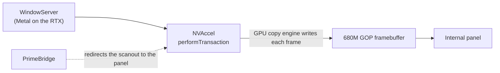

<div align="center">

# PrimeBridge

**NVIDIA-accelerated macOS on the internal screen of AMD laptops without a MUX switch**


</div>

On many AMD + NVIDIA laptops the internal screen is wired only to the AMD iGPU, and macOS has no driver for it. PrimeBridge lets macOS render on the NVIDIA GPU through the [NullMoth](https://nullmothsystems.com) Metal driver and shows the result on the internal screen. It reuses the framebuffer that the firmware (GOP) left on the iGPU and makes NullMoth's frames land in it.

> [!IMPORTANT]
> **Testers wanted.** PrimeBridge works on one laptop today. I want it to work on every MUX-less AMD + NVIDIA laptop, and I can only get there with reports from other machines. If you have one, try it and send a [test report](#feedback), even if it fails. Reports from other Radeon iGPUs (780M, 760M) help too: they show which offsets need to change. You can also reach me on Discord: **@64417**.



## Status

Version 0.7.1 installs with one command: `./install.sh` finds the NullMoth version, the iGPU, the panel and the OpenCore EFI partition, builds the patched NullMoth kexts for that exact version and macOS, and installs everything. It runs on the laptop below with NullMoth 2.6.3, where the RTX copy engine writes frames straight into the panel's buffer and the forced mode is 72 Hz on the 144 Hz panel. The patch also builds for NullMoth 2.7.2 and 2.8.1, for macOS 15 and 26, but those have not run on a laptop yet.

| | |
|---|---|
| Laptop | Acer Nitro V 15 ANV15-41 |
| CPU | Ryzen 5 7535HS |
| iGPU | Radeon 680M (`1002:1681`) |
| dGPU | GeForce RTX 4050 Laptop |
| Panel | 1920x1080, 144 Hz |
| Software | macOS 26.7.2, NullMoth 2.6.3 |

No other laptop has been tested yet.

> [!WARNING]
> PrimeBridge is a kernel extension. It writes to the iGPU's memory and installs patched builds of two NullMoth kexts. It comes with no warranty. Keep an HDMI monitor at hand for your first boots, and try it from a USB stick first if you can.

## Requirements

- A laptop whose internal panel is wired only to an AMD iGPU that macOS has no driver for: Radeon 680M / 660M (`1002:1681`, the only one tested), 780M / 760M / 740M (`15bf`, `15c8`, `1900`, `1901`), 890M / 880M (`150e`), 860M / 840M / 820M (`1114`, `1902`), 8060S / 8050S (`1586`) or 610M (`164e`, `13c0`, `1506`). Vega iGPUs are not matched, since NootedRed drives them. Intel iGPUs are not matched yet.
- An NVIDIA GPU that NullMoth drives, with NullMoth 2.6.3 or later already working: a monitor plugged into the NVIDIA GPU shows an accelerated desktop.
- An HDMI port wired to the NVIDIA GPU, with nothing plugged into it at boot. That is the case on most gaming laptops: a monitor on that port shows NullMoth's desktop. A laptop without one cannot use PrimeBridge yet.
- OpenCore, with `Misc > Security > Vault` set to `Optional`.
- macOS 15 or 26, already booting normally (USB ports mapped and so on).
- The Xcode Command Line Tools (`xcode-select --install`) and internet access for the first build, which downloads about 170 MB (NullMoth's source and NVIDIA's open-gpu-kernel-modules headers).
- A 32 bpp firmware boot framebuffer inside the iGPU's BAR0. PrimeBridge checks this and refuses otherwise.

## Installation

```bash
git clone https://github.com/myvoow/PrimeBridge.git
cd PrimeBridge
./install.sh
```

`install.sh` runs as your user and asks for your password before it changes anything. It:

1. Checks the Mac: macOS version, Command Line Tools, NullMoth version and that it runs, the NVIDIA GPU and the iGPU, the panel resolution and refresh rate, and OpenCore's EFI partition (from the boot path OpenCore records in NVRAM). `./install.sh --dry-run` shows what it finds and stops there.
2. Builds NullMoth's NVRMFB and NVAccel for the installed NullMoth version and macOS version, with the patch and a forced EDID made for the panel, then builds PrimeBridge. When it has the original kexts, it also checks that its unpatched builds match them byte for byte. A difference only means another compiler than NullMoth's, and the build is used anyway.
3. Edits OpenCore's `config.plist`, after saving a copy in `/Library/PrimeBridge`: adds PrimeBridge to `Kernel > Add`, adds the missing boot-args (`nvfb=1 nvaccel=1 nvfbforce=1 nvcursor=0 -nvrmnoflip`, plus `gfxrst=4` with WhateverGreen), removes `-primeoff`, and turns off the Fix PAT kernel patches ([why](#why-fix-pat-must-be-off)).
4. Installs the patched NVRMFB and NVAccel, keeps NullMoth's originals in `/Library/PrimeBridge`, and rebuilds the auxiliary kernel collection.

Then approve the extensions in System Settings > Privacy & Security if macOS asks, unplug any monitor from the NVIDIA GPU, restart, and run `./doctor.sh`. The direct mode starts a few seconds after the first frame reaches the panel.

When detection fails, give it what it could not find: `--panel 1920x1080`, `--panel-hz 144` or `--efi disk0s1`.

The forced HDMI mode runs at a whole divisor of the panel's refresh rate (72 Hz on a 144 Hz panel). On a first install PrimeBridge has not measured the panel yet, so the mode is 60 Hz. After the restart, `./doctor.sh` says when running `./install.sh` again gives a better rate.

`nvfb=1 nvaccel=1` belong to NullMoth, which needs its own boot-args too (see its docs). `nvfbforce=1` creates the fake HDMI monitor. `nvcursor=0` turns off the NVIDIA hardware cursor, so macOS draws the cursor into the frame and it shows on the panel.

### After a NullMoth update

NullMoth's updater puts its own NVRMFB and NVAccel back. Until `./install.sh` runs again, PrimeBridge steps aside after 2 minutes and the panel gets macOS's basic display driver, without acceleration. A notification at login says so.

### Rollback

- `./uninstall.sh` puts NullMoth's original kexts back, removes PrimeBridge and the boot-args it added from OpenCore, and turns the Fix PAT patches it disabled back on. Restart afterwards. Every `config.plist` the scripts changed is saved in `/Library/PrimeBridge`.
- Black internal screen: add `-primeoff` to the boot-args to stop PrimeBridge. You can also plug a monitor into the NVIDIA GPU before booting: nothing is forced then, the monitor works as usual and the panel mirrors it. When no NVIDIA head comes up within 2 minutes, PrimeBridge steps aside by itself so macOS's basic display driver can take the panel.

## Checking that it works

```bash
./doctor.sh
```

It prints PrimeBridge's mode and, when something is wrong, what to do about it. The details are in `/var/log/PrimeBridge.log`, started over at boot once it passes 8 MB.

```bash
tail -40 /var/log/PrimeBridge.log
ioreg -rc PrimeBridge -d1 | grep -E "Version|PrimeMode"
```

A healthy start:

```
PrimeBridge 0.7.1 starting (log=1)
FB 1920x1080 bpp 32 stride 7680 B ... phys 0x490000000 ... BAR0 0x490000000 +0x10000000
found NVRMNVDAFramebuffer 1920x1080 pitch 7680 phys 0x...
NVAccel's present path armed after about 200 ms
redirected NVRMNVDAFramebuffer scanout kva to cached staging (8323072 bytes; NVRMFB allocation 8323072, GOP mapping 8323072)
igpu probe: FB_OFFSET 0x00000440 FB_LOCATION 0x0000f400..0x0000f41f -> VRAM at phys 0x440000000, 512 MB; GOP at VRAM +0x0
igpu probe: phys 0x440000000: 32 of 32 pixels written through BAR0 read back there -> MATCH
igpu writes: PAT 0x... (PA6 WC)
igpu writes: ns per row: BAR0 2004, BAR0 write-combined 2343, VRAM write-combined 1355 -> VRAM at phys, fast
NVAccel now puts its frames straight into the panel's buffer, with the GPU copy engine (no staging copy, no diff)
rate-hint: 4 Hz (idle), work avg 0 us ..., panel 143.78 Hz, direct
```

When something is off:

- `PA6 not WC` with writes around 40 µs per row: the Fix PAT patch is still active.
- `no NVIDIA head after 60 s: ...` (`PrimeMode` is `no-nvidia-head`): NVRMFB did not create head 0, and the line says why, from what NVRMFB reports. The NVIDIA GPU has no HDMI port to force, NVKMS refused the forced display, `nvfbforce=1` is missing, or the NVRMFB is not the one `install.sh` built (a NullMoth update put its own back): run `./install.sh` again. After 2 minutes PrimeBridge steps aside (`still no NVIDIA head after 2 min`).
- `PrimeMode` is `no-nvaccel-present`: the NVIDIA head exists but NVAccel never armed its present path. Check `nvaccel=1`.
- `a display is plugged into the NVIDIA GPU`: nothing was forced at boot. That monitor works as usual and the panel shows a copy of it (its top-left 1920x1080 when it is larger), in staging mode, which costs more CPU than direct mode.
- No `direct` at the end of the `rate-hint` lines: compare `NVRMFB allocation` and `GOP mapping` on the `redirected` line. If the allocation is larger, NVRMFB can switch to a mode larger than the panel's buffer, so PrimeBridge stays in staging mode to keep it from writing past that buffer.
- `NVRMFB reports a scanout allocation of 0 bytes`: this NVRMFB lacks the patch from this release (0.4.x, or NullMoth's own). PrimeBridge does not redirect and copies from NVIDIA memory instead, which is slow. Run `./install.sh` again.
- `this NVRMFB has no nvScanoutRedirect`: the NVRMFB was patched by an older release. Run `./install.sh` again.
- NullMoth's counters can help: `sysctl debug.nvaccel_iop_ok debug.nvaccel_surface_gpu_timeouts debug.nvaccel_iop_copy_skip`.

## Feedback

Open an issue with the [Test report](../../issues/new?template=test-report.yml) template, or reach me on Discord: **@64417**.

The template asks for the laptop model, PCI IDs, panel resolution, macOS and NullMoth versions, the output of `./install.sh --dry-run` and `./doctor.sh`, the `ioreg` output and the end of the log. With those I can narrow down most problems without a back-and-forth.

## How it works

### The problem

The internal panel is physically connected to the iGPU, which macOS cannot drive. NullMoth drives the NVIDIA GPU, but its accelerator (NVAccel) runs only when an NVIDIA display head exists, and that normally needs a monitor on the NVIDIA card. Meanwhile the firmware's GOP has already lit the panel and left the iGPU scanning out a plain framebuffer in its own memory (1920x1080, 32 bpp, BGRX on the test machine). Anything written there appears on the panel.

### The data path

1. With `nvfbforce=1`, NVRMFB makes the first HDMI connector of the NVIDIA GPU report itself connected when nothing is plugged in. Its EDID is named "PrimeBridge" and `install.sh` makes it for the panel: the panel's resolution, at a whole divisor of its refresh rate (1920x1080 at 72 Hz, 160.85 MHz on the test laptop). Head 0 exists, WindowServer composites on the RTX with Metal, and NVAccel runs. This works on HDMI only: DisplayPort needs a real sink to train the link.
2. Every frame, WindowServer's swap goes through `NVDisplayPipe::performTransaction` in NullMoth's `nvrm-accel.cpp`. With zero-copy flips off (`debug.nvaccel_iop_flip=0`, which PrimeBridge enforces), stock NVAccel pages the frame out of VRAM, then copies it with the CPU to the scanout address NVRMFB gives it (`fKva`).
3. PrimeBridge finds `NVRMNVDAFramebuffer` and calls `nvScanoutRedirect`, which the patch adds to NVRMFB. From then on `nvScanoutInfo` hands NVAccel PrimeBridge's buffer instead of NVRMFB's own.
4. PrimeBridge starts in staging mode. The scanout points to a cached RAM buffer the size of NVRMFB's whole scanout allocation (`fMemBytes`, which the patched NVRMFB reports), so a later, larger mode still fits. A 60 Hz timer (20 Hz when idle) compares it row by row with a shadow copy, only after NVAccel's frame counter (`debug.nvaccel_iop_ok`) has moved, and writes the changed rows to the GOP framebuffer.
5. On the first timer tick without a new frame, a few seconds after the first frame reaches the panel, PrimeBridge probes the iGPU. On the 680M it maps the register BAR (BAR5) and reads `GCMC_VM_FB_OFFSET` to find where the iGPU's VRAM sits in system RAM (`0x440000000`, 512 MB on the test machine), as Linux amdgpu does on x86 APUs. It writes 32 pixels through BAR0, reads them back from that RAM, puts the old values back within microseconds and logs `MATCH`, whatever is on screen. Then it times rewriting 64 identical rows (invisible on screen) through BAR0 as mapped at boot, BAR0 write-combined, and VRAM write-combined, and keeps the fastest mapping. Only the 32 test pixels, these timed rewrites and the final switch write anything.

   If writes take under 3 µs per row, the NVIDIA mode has exactly the panel's width, height and pitch, and NVRMFB's allocation fits in the panel's mapping, PrimeBridge points the scanout straight at the panel's framebuffer. When that framebuffer is the iGPU's VRAM in system RAM, PrimeBridge also hands NVRMFB its physical address, and the patched NVAccel has the RTX copy engine write each frame there by DMA, with no CPU copy at all. Frames whose newest pixels are not in VRAM still go through the CPU. The staging copy and the row diff drop out, and the PrimeBridge timer drops to 4 Hz to watch the geometry. The log says `direct` and `PrimeMode` becomes `direct-copy-engine` (`direct-kva` when the panel's buffer is in BAR0).
6. Every 64 timer ticks (every tick in direct mode) PrimeBridge re-reads the NVIDIA scanout geometry. If it changed (resolution switch), PrimeBridge asks NVRMFB to take its own buffer back, falls back to staging, and goes direct again once the geometry matches.
7. On the 680M, PrimeBridge also reads the OTG frame counter and logs the panel's real refresh rate on every `rate-hint` line.

PrimeBridge never writes to the VRAM address unless it first read back there exactly what it had written through BAR0.

### Why Fix PAT must be off

macOS maps write-combined (WC) memory through PAT entry PA6. AMD Vanilla's `_mtrr_update_action | Fix PAT` patches (Algrey's is on by default) replace macOS's PAT with `0x0007010600070106`, where PA6 is UC- (uncached). Every WC mapping in macOS then becomes uncached, PrimeBridge's writes and CPU access to NVIDIA VRAM included.

Measured on the test machine, per 7680-byte row:

| | Fix PAT on | Fix PAT off |
|---|---|---|
| BAR0 | 39.7 µs | 2.0 µs |
| iGPU VRAM, write-combined | 75.4 µs | 1.4 µs (about 5.7 GB/s) |
| Result | staging mode, `kernel_task` at 75 % in video | direct mode, `kernel_task` at 2.5 % |

AMD Vanilla's own README says the patch does not improve performance and that some systems run better without it. Test without it on a USB stick first.

## Adapting it to another laptop

### Panel resolution

Direct mode needs the NVIDIA mode to equal the GOP framebuffer: same width, height and pitch (width x 4). `install.sh` makes the forced EDID from the panel's resolution (`NVRMFB-patch/gen_edid.py`, CVT reduced blanking v2), and the pitch matches for the usual widths. Above 165 MHz the EDID gets a CTA-861 block that declares HDMI up to 340 MHz, and a mode that would need more gets a lower divisor of the panel's rate (a 4K panel gets 30 Hz). Only 1920x1080 has run on a laptop so far.

### A different iGPU

The GOP framebuffer path is the same on every iGPU PrimeBridge matches. Only the optional VRAM probe and the panel refresh readout use registers, taken from the Linux amdgpu headers for Rembrandt (`yellow_carp_offset.h`, `gc_10_3_0_offset.h`, `dcn_3_1_2_offset.h`), so they run on the 680M only. The other iGPUs time BAR0 writes instead, and go direct when BAR0 write-combined is fast enough. For an AMD iGPU that is not listed, add its ID to `IOPCIPrimaryMatch` in `Info.plist`.

### Another NullMoth version

PrimeBridge does not touch NVRMFB's private fields: it calls `nvScanoutRedirect` and reads `nvScanoutInfo`, both answered by the patched NVRMFB. `nvScanoutInfo` also reports the scanout allocation (`fMemBytes`) and, once the scanout is redirected to memory with a physical address, flags it and gives that address to NVAccel. NVRMFB also publishes two properties on NVRM: `nvfbforce-display`, the forced display or 0, and `nvfbforce`, what the force pass did (`forced`, `monitor`, `no-hdmi`, `refused` or `off`).

`install.sh` rebuilds NVRMFB and NVAccel for whatever NullMoth version is installed. It clones that NullMoth tag, and NVIDIA's open-gpu-kernel-modules at the release the tag is built on, into `~/Library/Caches/PrimeBridge`. The release comes from `NV_XNU_FW_DIR` in NullMoth's `kexts/NVRM/os-xnu2.cpp`. NullMoth's docs lag behind: 2.8.1's docs say 615.78.08 and its code uses 620.70.06. The same `nvfbforce.patch` applies to every tag from v2.6.3 to v2.8.1, and `install.sh` stops on a version it does not apply to.

To build by hand:

```bash
PANEL=1920x1080 PANELHZ=144 sh NVRMFB-patch/build-nvrmfb.sh 2.8.1 [stock NVRMFB binary] [stock NVAccel binary]
```

NullMoth builds a different NVAccel for macOS 15 and 26: the script builds for the Mac it runs on, and `MACOS_MAJOR=15` or `26` picks the other one. `WORK=` and `OGKM=` point it to existing checkouts, `OGKM_TAG=` overrides the NVIDIA release, and `EXTRA_PATCH=` applies one more patch after `nvfbforce.patch`. The result is in `nullmoth-<version>/patched`, and `sudo sh install-nvrmfb.sh <NVRMFB.kext> <NVAccel.kext>` installs it.

## Boot-args

| Boot-arg | Effect |
|---|---|
| `-primeoff` | PrimeBridge does not load (escape hatch) |
| `-primelogoff` | No log file |
| `primecarve=0` | Skip the VRAM probe and write benchmark (stays on BAR0, no direct mode) |
| `primehz=N` | Staging timer rate (default 60, 24 to 240) |
| `primefmt=N` | Pixel packing in staging mode: 1 = BGRX (default), 2 = RGBX, 3 = raw. Direct mode runs only with 1 |
| `primemirror=1` | Copy each frame to a monitor plugged into the NVIDIA GPU too (staging mode only). On by itself when such a monitor was there at boot |
| `primetest=1/2/3`, `primecolors=1` | Test patterns on the panel during boot, for checking colors and stride |

## Building

On a Mac with the Command Line Tools (Xcode is not needed):

```bash
cd PrimeBridge-source
sh build.sh
```

`build.sh` uses the SDK `xcrun --show-sdk-path` reports; set `SDK=` to use another one. The output is `build/PrimeBridge.kext`, ad-hoc signed. Kernel code must not use floating point, so this has to print 0:

```bash
otool -tV build/PrimeBridge.kext/Contents/MacOS/PrimeBridge | grep -cE "cvtsi2sd|divsd"
```

### Where to start in the code

- `PrimeBridge.cpp`: `attachNvidiaScanout()` does the redirect, `probeIgpu()` and `chooseWriteMapping()` probe the iGPU and benchmark the writes, and `tickNullMoth()` runs the staging copy, the geometry check and the switch to direct mode.
- `BootFramebuffer.cpp` maps the GOP framebuffer (`attach()`, `mapWriteCombined()`).
- `NVRMFB-patch/nvfbforce.patch` is the NVIDIA side: the forced HDMI display and `nvScanoutRedirect` in NVRMFB, and `nvAccelIopToPanel`, the copy engine path of `NVDisplayPipe::performTransaction`, in NVAccel.

Diagnose from `/var/log/PrimeBridge.log` and `ioreg -rc PrimeBridge` before changing code. [`llms.txt`](llms.txt) holds the full technical notes, for people and AI assistants working on the code.

## Known limits

- PrimeBridge needs an HDMI port on the NVIDIA GPU. Laptops whose NVIDIA GPU has only DisplayPort or USB-C outputs, or none, are not supported yet.
- The fake HDMI monitor runs at a divisor of the panel's rate (72 Hz on a 144 Hz panel), so each frame stays up for the same number of refreshes. The two clocks are independent, so every few seconds one frame shows for one refresh more or less.
- NVAccel waits up to 100 ms for a composite to finish before copying (`kSurfGpuWaitMs` in `nvrm-accel.cpp`). The test machine still hits a few of these per 10 minutes (`debug.nvaccel_surface_gpu_timeouts`), seen as short freezes.
- Tearing is possible, because the iGPU scans out the same buffer NVAccel writes into (no double buffering).
- Sleep and wake are untested.
- Only the 680M has been tested. NullMoth's opt-in AMD and Intel test driver (NMDRM) attaches to the same iGPU and has not been tried with PrimeBridge.
- A smaller mode picked in System Settings shows top-left without scaling.
- The RTX stays powered all the time since it renders the desktop, so battery life is limited.

## Repository contents

| Path | What it is |
|---|---|
| `install.sh`, `doctor.sh`, `uninstall.sh` | Install, check and remove PrimeBridge. All three run `primebridge.py` |
| `primebridge.py` | Detection, OpenCore editing and the install state in `/Library/PrimeBridge` |
| `PrimeBridge-source/` | Driver sources and `build.sh` |
| `NVRMFB-patch/nvfbforce.patch` | The change to NullMoth's NVRMFB (`nvrm-fb.cpp`) and NVAccel (`nvrm-accel.cpp`), for tags v2.6.3 to v2.8.1 |
| `NVRMFB-patch/build-nvrmfb.sh`, `gen_edid.py`, `test_nvfbforce.py` | Rebuild NVRMFB and NVAccel with the patch for a NullMoth version, make the forced EDID, and check the patch |
| `NVRMFB-patch/NullMoth-LICENSE`, `NullMoth-NOTICE` | NullMoth's license and notice |
| `install-nvrmfb.sh` | Installs the patched `NVRMFB.kext` and `NVAccel.kext`, keeps your originals, rebuilds the auxiliary kernel collection |
| `llms.txt` | Full technical notes in one file |

## License

PrimeBridge (`PrimeBridge-source/`, the scripts at the top of the repository and the docs) is under the [MIT License](LICENSE). You can use, modify and redistribute it for free. Any copy or derived work has to keep the copyright notice, which carries the link to this repository.

`NVRMFB-patch/` and the patched `NVRMFB.kext` and `NVAccel.kext` are derived from NullMoth and stay under the [PolyForm Noncommercial License 1.0.0](NVRMFB-patch/NullMoth-LICENSE): noncommercial use only. Copyright (c) 2026 NullMoth Systems ([nullmothsystems.com](https://nullmothsystems.com)). This project is not affiliated with NullMoth Systems.

Thanks to nullmoth for the amazing work, and litemint09 for the amazing content
