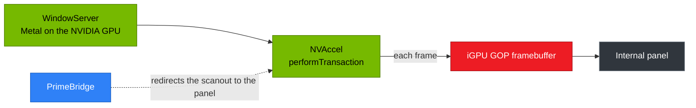

<div align="center">

# PrimeBridge

### NVIDIA-accelerated macOS on the internal screen of AMD laptops without a MUX switch

<br>


<br>

**[Install](docs/install.md)** &nbsp;&middot;&nbsp;
**[FAQ](docs/faq.md)** &nbsp;&middot;&nbsp;
**[Compatibility](docs/compatibility.md)** &nbsp;&middot;&nbsp;
**[Troubleshooting](docs/troubleshooting.md)** &nbsp;&middot;&nbsp;
**[How it works](docs/how-it-works.md)** &nbsp;&middot;&nbsp;
**[Development](docs/development.md)**

</div>

<br>

On many AMD + NVIDIA laptops the internal screen is wired only to the AMD iGPU, and macOS has no driver for it. PrimeBridge lets macOS render on the NVIDIA GPU through the [NullMoth](https://nullmothsystems.com) Metal driver and shows the result on the internal screen. It reuses the framebuffer that the firmware (GOP) left on the iGPU and makes NullMoth's frames land in it.



> [!IMPORTANT]
> **Testers wanted.** If you have a MUX-less AMD + NVIDIA laptop, try PrimeBridge and send a [test report](#feedback), even if it fails. Reports from iGPUs other than the 680M / 660M help the most.

## Status

Version 0.7.1 installs with one command: `./install.sh` finds the NullMoth version, the iGPU, the panel and the OpenCore EFI partition, builds the patched NullMoth kexts for that exact version and macOS, and installs everything. It supports [19 AMD iGPU PCI IDs](docs/compatibility.md#supported-igpus), from Vega to the Radeon 890M and 8060S.

PrimeBridge works correctly on these two laptops, which both use iGPU ID `1002:1681`:

| CPU | NVIDIA GPU | PrimeBridge |
|:---|:---|:---:|
| Ryzen 5 7535HS | GeForce RTX 4050 Laptop | 0.7.1 |
| Ryzen 7 6800H | RTX 3050 | 0.7.1 |

> [!NOTE]
> PrimeBridge is still a work in progress, and the optimization is not the best yet.

> [!TIP]
> NullMoth 2.9 has the same idea built in: its experimental hybrid mode (`NMGopFB.kext`, boot-arg `nmhybrid=1`) maps the firmware framebuffer the way PrimeBridge does, with my permission. On 2.9 it may work for you too, and it is simpler to set up ([NullMoth's guide](https://github.com/nullmoth/nvidia-macos-driver/blob/v2.9/docs/HYBRID-LAPTOPS.md)). PrimeBridge itself does not support 2.9 yet.

## Requirements

| | |
|:---|:---|
| iGPU | An AMD iGPU from the [supported list](docs/compatibility.md#supported-igpus), with the internal panel wired only to it |
| NVIDIA GPU | NullMoth 2.6.3 to 2.8.1 already working (2.9 is not supported yet) |
| HDMI | A port wired to the NVIDIA GPU, with nothing plugged into it at boot |
| Bootloader | OpenCore, with `Misc > Security > Vault` set to `Optional` |
| macOS | 15 or 26, and the Xcode Command Line Tools |

## Installation

```bash
git clone https://github.com/myvoow/PrimeBridge.git
cd PrimeBridge
./install.sh
```

Approve the extensions in System Settings > Privacy & Security if macOS asks, unplug any monitor from the NVIDIA GPU, restart, and run `./doctor.sh`. `./uninstall.sh` removes everything. The [install guide](docs/install.md) has the details.

> [!WARNING]
> PrimeBridge is a kernel extension. It writes to the iGPU's memory and installs patched builds of two NullMoth kexts. It comes with no warranty. Keep an HDMI monitor at hand for your first boots, and try it from a USB stick first if you can.

## Documentation

<table>
  <tr>
    <td width="33%" valign="top"><a href="docs/install.md"><b>Install guide</b></a><br>What <code>install.sh</code> does, options, NullMoth updates, rollback</td>
    <td width="33%" valign="top"><a href="docs/troubleshooting.md"><b>Troubleshooting</b></a><br><code>doctor.sh</code>, logs, common errors, boot-args</td>
    <td width="33%" valign="top"><a href="docs/faq.md"><b>FAQ</b></a><br>Is my laptop supported, black screen, 72 Hz, battery, removal</td>
  </tr>
  <tr>
    <td valign="top"><a href="docs/compatibility.md"><b>Compatibility</b></a><br>Supported iGPUs, tested laptops, known limits</td>
    <td valign="top"><a href="docs/how-it-works.md"><b>How it works</b></a><br>The data path and why Fix PAT must be off</td>
    <td valign="top"><a href="docs/development.md"><b>Development</b></a><br>Adapting it to another laptop, building, repository contents</td>
  </tr>
</table>

The full technical notes are in one file: [`llms.txt`](llms.txt).

## Feedback

Open an issue with the [Test report](../../issues/new?template=test-report.yml) template, or reach me on Discord: **@64417**.

The template asks for the laptop model, PCI IDs, panel resolution, macOS and NullMoth versions, the output of `./install.sh --dry-run` and `./doctor.sh --report`, which ends with the log, and the `ioreg` output. With those I can narrow down most problems without a back-and-forth.

## License

PrimeBridge (`PrimeBridge-source/`, the scripts at the top of the repository and the docs) is under the [MIT License](LICENSE). You can use, modify and redistribute it for free. Any copy or derived work has to keep the copyright notice, which carries the link to this repository.

`NVRMFB-patch/` and the patched `NVRMFB.kext` and `NVAccel.kext` are derived from NullMoth and stay under the [PolyForm Noncommercial License 1.0.0](NVRMFB-patch/NullMoth-LICENSE): noncommercial use only. Copyright (c) 2026 NullMoth Systems ([nullmothsystems.com](https://nullmothsystems.com)). This project is not affiliated with NullMoth Systems.

<br>

<p align="center">Thanks to nullmoth for the amazing work, and litemint09 for the amazing content</p>
