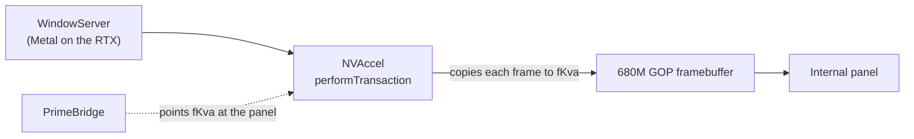

<div align="center">

# PrimeBridge

**NVIDIA-accelerated macOS on the internal screen of AMD laptops without a MUX switch**


</div>

On many AMD + NVIDIA laptops the internal screen is wired only to the AMD iGPU, and macOS has no driver for it. PrimeBridge lets macOS render on the NVIDIA GPU through the [NullMoth](https://nullmothsystems.com) Metal driver and shows the result on the internal screen. It reuses the framebuffer that the firmware (GOP) left on the iGPU and makes NullMoth's frames land in it.

> [!IMPORTANT]
> **Testers wanted.** PrimeBridge works on one laptop today. I want it to work on every MUX-less AMD + NVIDIA laptop, and I can only get there with reports from other machines. If you have one, try it and send a [test report](#feedback), even if it fails. Reports from other Radeon iGPUs (780M, 760M, Vega) help too: they show which offsets need to change. You can also reach me on Discord: **@64417**.



## Status

Version 0.4.8 runs every day on one laptop:

| | |
|---|---|
| Laptop | Acer Nitro V 15 ANV15-41 |
| CPU | Ryzen 5 7535HS |
| iGPU | Radeon 680M (`1002:1681`) |
| dGPU | GeForce RTX 4050 Laptop |
| Panel | 1920x1080, 144 Hz |
| Software | macOS 26.7.2, NullMoth 2.6.3 |

No other laptop has been tested yet.

> [!WARNING]
> PrimeBridge is a kernel extension. It writes to the iGPU's memory and changes a private pointer inside NullMoth's NVRMFB kext. It comes with no warranty. Keep an HDMI monitor at hand for your first boots, and try it from a USB stick before touching your internal install.

## Requirements

- An AMD Rembrandt or Rembrandt-R APU with a Radeon 680M, PCI ID `1002:1681`. PrimeBridge matches only that ID, and its register offsets are for GC 10.3.3 / DCN 3.1.2.
- An NVIDIA GPU supported by NullMoth, running **NullMoth 2.6.3 exactly**: NVRM, NVAccel and NVRMAGDC from NullMoth, plus the patched NVRMFB from this project's release. PrimeBridge checks NVRMFB's field offsets and refuses to redirect if they do not match.
- At least one HDMI connector wired to the NVIDIA GPU, with nothing plugged into it.
- macOS already booting normally (USB ports mapped and so on). PrimeBridge does not fix boot problems.
- A 32 bpp firmware boot framebuffer inside the iGPU's BAR0. PrimeBridge checks this and refuses otherwise.

## Installation

Download `PrimeBridge-0.4.8.zip` from the [Releases](../../releases) page. It contains:

| File | md5 of the binary |
|---|---|
| `PrimeBridge.kext` | `5048ff6bac5cc0ae7ac8b1beb6f4d838` |
| `NVRMFB.kext` (NullMoth 2.6.3 with the `nvfbforce` patch) | `6a3402872b7b14a5485aeda97afc7df2` |
| `install-nvrmfb.sh` | |

1. Get macOS booting with NullMoth 2.6.3 on an external monitor first.
2. Install the patched NVRMFB from the unzipped folder:
   ```bash
   sudo sh install-nvrmfb.sh
   ```
   Approve the update in System Settings > Privacy & Security if macOS asks, then reboot.
3. Copy `PrimeBridge.kext` to `EFI/OC/Kexts/` and add it to `Kernel > Add` in `config.plist` (BundlePath `PrimeBridge.kext`, ExecutablePath `Contents/MacOS/PrimeBridge`, PlistPath `Contents/Info.plist`, Enabled true; no MinKernel or MaxKernel needed).
4. In `Kernel > Patch`, disable `Algrey / Zormeister | _mtrr_update_action | Fix PAT | 15.0+` and leave the Shaneee variants disabled. [Why](#why-fix-pat-must-be-off).
5. Add these boot-args next to your own:
   ```
   debug=0x100 keepsyms=1 nvfb=1 nvaccel=1 nvfbheads=4 -nvkmsnosmooth -nvrmnoflip nvfbforce=1 nvcursor=0
   ```
   `nvfb=1 nvaccel=1` belong to NullMoth (see its docs for the others). `nvfbforce=1` creates the fake HDMI monitor. `nvcursor=0` turns off the NVIDIA hardware cursor, so macOS draws the cursor into the frame and it shows on the panel.
6. Unplug any monitor from the NVIDIA GPU and reboot. After login, leave a still desktop on screen for about a minute so the probe can run.

### Rollback

- Black internal screen: plug an HDMI monitor into the NVIDIA GPU (the fake connector exists only when nothing is plugged in), or add `-primeoff` to the boot-args to stop PrimeBridge.
- Original NVRMFB: `sudo sh install-nvrmfb.sh NVRMFB-2.6.3-orig.kext`, then reboot.

## Checking that it works

PrimeBridge logs to `/var/log/PrimeBridge.log`.

```bash
tail -40 /var/log/PrimeBridge.log
ioreg -rc PrimeBridge -d1 | grep -E "Version|PrimeMode"
```

A healthy start:

```
PrimeBridge 0.4.8 starting (log=1)
FB 1920x1080 bpp 32 stride 7680 B ... phys 0x490000000 ... BAR0 0x490000000 +0x10000000
found NVRMNVDAFramebuffer 1920x1080 pitch 7680 phys 0x...
redirected NVRMNVDAFramebuffer scanout kva to cached staging (8294400 bytes)
igpu probe: FB_OFFSET 0x00000440 FB_LOCATION 0x0000f400..0x0000f41f -> VRAM at phys 0x440000000, 512 MB; GOP at VRAM +0x0
igpu probe: phys 0x440000000, 61440 px: 0 differ from what we wrote (61434 lit), ... -> MATCH
igpu writes: PAT 0x... (PA6 WC)
igpu writes: ns per row: BAR0 2004, BAR0 write-combined 2343, VRAM write-combined 1355 -> VRAM at phys, fast
NVAccel now writes its frames straight into the panel's buffer (no staging copy, no diff)
rate-hint: 20 Hz (idle), work avg 0 us ..., panel 143.78 Hz, direct
```

When something is off:

- `inconclusive (screen too dark)`: the probe tries again on a later still screen. Leave something bright on screen.
- `PA6 not WC` with writes around 40 µs per row: the Fix PAT patch is still active.
- No `found NVRMNVDAFramebuffer` line: NVRMFB did not create head 0. Check `nvfbforce=1`, that nothing is plugged into the NVIDIA GPU, and that the NVIDIA GPU has an HDMI connector.
- NullMoth's counters can help: `sysctl debug.nvaccel_iop_ok debug.nvaccel_surface_gpu_timeouts debug.nvaccel_iop_copy_skip`.

## Feedback

The goal is a driver that works on any MUX-less AMD + NVIDIA laptop. Open an issue with the [Test report](../../issues/new?template=test-report.yml) template, or reach me on Discord: **@64417**.

The template asks for the laptop model, PCI IDs, panel resolution, macOS and NullMoth versions, the Fix PAT setting, the `ioreg` output and the end of the log. With those, most problems can be narrowed down without a back-and-forth.

## How it works

### The problem

The internal panel is physically connected to the iGPU, which macOS cannot drive. NullMoth drives the NVIDIA GPU, but its accelerator (NVAccel) runs only when an NVIDIA display head exists, and that normally needs a monitor on the NVIDIA card. Meanwhile the firmware's GOP has already lit the panel and left the iGPU scanning out a plain framebuffer in its own memory (1920x1080, 32 bpp, BGRX on the test machine). Anything written there appears on the panel.

### The data path

1. **NVRMFB with `nvfbforce=1`.** When nothing is plugged in, the first HDMI connector of the NVIDIA GPU reports itself connected, with a built-in EDID named "PrimeBridge" (1920x1080 at 60 Hz, 148.5 MHz). Head 0 exists, WindowServer composites on the RTX with Metal, and NVAccel runs. This trick works on HDMI only: DisplayPort needs a real sink to train the link.
2. **NVAccel's present.** Every frame, WindowServer's swap goes through `NVDisplayPipe::performTransaction` in NullMoth's `nvrm-accel.cpp`. With zero-copy flips off (`debug.nvaccel_iop_flip=0`, which PrimeBridge enforces), NVAccel copies the composited IOSurface with the CPU to the framebuffer address it gets from NVRMFB (`fKva`).
3. **PrimeBridge redirects `fKva`.** It finds `NVRMNVDAFramebuffer`, checks its private fields against the public `nvScanoutInfo` call, then overwrites `fKva` (object offset `0x2d8` in NVRMFB 2.6.3).
4. **Staging mode.** At first `fKva` points to a cached RAM buffer. A 60 Hz timer (20 Hz when idle) compares it row by row with a shadow copy and writes the changed rows to the GOP framebuffer.
5. **Probe and direct mode.** About a minute after boot, on a still screen, PrimeBridge maps the iGPU's register BAR (BAR5) and reads `GCMC_VM_FB_OFFSET` to find where the iGPU's VRAM sits in system RAM (`0x440000000`, 512 MB on the test machine), as Linux amdgpu does on x86 APUs. It compares 32 rows read there with what it wrote and logs `MATCH`. Then it times rewriting 64 identical rows (invisible on screen) through BAR0 as mapped at boot, BAR0 write-combined, and VRAM write-combined, and keeps the fastest mapping. Only these timed rewrites and the final switch write anything.

   If writes take under 3 µs per row and the NVIDIA mode has exactly the panel's width, height and pitch, PrimeBridge points `fKva` straight at the panel's framebuffer. From then on NVAccel writes each frame directly to the screen, and the staging copy, the row diff and the PrimeBridge timer all drop out. The log says `direct` and `PrimeMode` becomes `direct-kva`.
6. **Geometry check.** Every 64 timer ticks PrimeBridge re-reads the NVIDIA scanout geometry. If it changed (resolution switch, re-allocation), PrimeBridge restores NVRMFB's original pointer, falls back to staging, and goes direct again once the geometry matches.
7. **Panel refresh.** PrimeBridge reads the iGPU's OTG frame counter and logs the panel's real refresh rate on every `rate-hint` line.

PrimeBridge never writes to the VRAM address unless it first read back there exactly what it had written through BAR0.

### Why Fix PAT must be off

macOS maps write-combined (WC) memory through PAT entry PA6. AMD Vanilla's `_mtrr_update_action | Fix PAT` patches (Algrey's is on by default) replace macOS's PAT with `0x0007010600070106`, where PA6 is UC- (uncached). Every WC mapping in macOS then becomes uncached, PrimeBridge's writes and CPU access to NVIDIA VRAM included.

Measured on the test machine, per 7680-byte row:

| | Fix PAT on | Fix PAT off |
|---|---|---|
| BAR0 | 39.7 µs | 2.0 µs |
| iGPU VRAM, write-combined | 75.4 µs | 1.4 µs (about 5.7 GB/s) |
| Result | staging mode, `kernel_task` at 75 % in video | direct mode, `kernel_task` at 2.5 % |

AMD Vanilla's own README says the patch does not improve performance and that some systems run better without it. Test without it on a USB stick first.

## Adapting it to another laptop

### Panel resolution

Direct mode needs the NVIDIA mode to equal the GOP framebuffer: same width, height and pitch (width x 4). The GOP usually runs the panel at its native resolution, which the `FB ...` log line shows. If it is not 1920x1080, PrimeBridge stays in staging mode and copies only the top-left 1920x1080 (cropped and slower).

The fix is a forced EDID with the panel's resolution in `kForcedEdid[128]` in `nvrm-fb.cpp` (see `nvfbforce.patch`), then a rebuild of NVRMFB from the NullMoth 2.6.3 sources.

- The mode lives in the first detailed timing descriptor, bytes 54 to 71. Byte 127 is the checksum: all 128 bytes must sum to 0 mod 256. The range-limits descriptor (`00 00 00 fd`) must allow the new refresh rate and pixel clock.
- Generate the EDID with a tool (an EDID editor, or `cvt -r` / `cvt` timings typed into one) and check it with `edid-decode`. Do not hand-edit it without recomputing the checksum.
- Without an HDMI vendor block, NVKMS caps the pixel clock at about 165 MHz. 1920x1200 at 60 Hz with CVT reduced blanking is 154 MHz and fits. 2560x1600 at 60 Hz (about 268 MHz) does not: it would need a 256-byte EDID with a CTA-861 extension declaring HDMI with a max TMDS clock of at least 340 MHz. The patch as written has a 128-byte buffer, and nobody has tried this yet.
- After the change, the log should show `found NVRMNVDAFramebuffer <W>x<H> pitch <W*4>` matching the `FB` line.

### A different iGPU

The register offsets in `PrimeBridge.cpp` (`kRegFbOffset`, `kRegOtg0*`) come from the Linux amdgpu headers for Rembrandt: `yellow_carp_offset.h` (GC_BASE seg0 `0x1260`, DCN_BASE seg2 `0x34C0`), `gc_10_3_0_offset.h` and `dcn_3_1_2_offset.h`. For another APU (780M, 760M, Vega), change the PCI ID in `Info.plist` and take the offsets from that chip's Linux headers. The `MATCH` check protects against a wrong address.

### Another NullMoth version

The `0x2d8` (`fKva`), `0x2e0`, `0x2f0`, `0x2f4` and `0x2f8` offsets in `attachNvidiaScanout()` were read from the NVRMFB 2.6.3 binary. If NullMoth changes the layout of `NVRMNVDAFramebuffer`, `NVFBOffsetsVerified` in `ioreg` turns false and PrimeBridge leaves NVRMFB alone. The `nvfbforce` patch also has to be re-applied to the new `nvrm-fb.cpp`.

## Boot-args

| Boot-arg | Effect |
|---|---|
| `-primeoff` | PrimeBridge does not load (escape hatch) |
| `-primelogoff` | No log file |
| `primecarve=0` | Skip the VRAM probe and write benchmark (stays on BAR0, no direct mode) |
| `primehz=N` | Staging timer rate (default 60, 24 to 240) |
| `primefmt=N` | Pixel packing in staging mode: 1 = BGRX (default), 2 = RGBX, 3 = raw. Direct mode runs only with 1 |
| `primetest=1/2/3`, `primecolors=1` | Test patterns on the panel during boot, for checking colors and stride |

## Building

On a Mac with the Command Line Tools (Xcode is not needed):

```bash
cd PrimeBridge-source
sh build.sh
```

`build.sh` expects `MacOSX15.4.sdk` from the Command Line Tools; set `SDK=` to use another one. The output is `build/PrimeBridge.kext`, ad-hoc signed. Kernel code must not use floating point, so this has to print 0:

```bash
otool -tV build/PrimeBridge.kext/Contents/MacOS/PrimeBridge | grep -cE "cvtsi2sd|divsd"
```

### Where to start in the code

- `PrimeBridge.cpp`: `attachNvidiaScanout()` does the redirect, `probeIgpu()` and `chooseWriteMapping()` probe the iGPU and benchmark the writes, and `tickNullMoth()` runs the staging copy, the geometry check and the switch to direct mode.
- `BootFramebuffer.cpp` maps the GOP framebuffer (`attach()`, `mapWriteCombined()`).
- `NVRMFB-patch/nvfbforce.patch` is the NVIDIA side. The frame copy into `fKva` is `NVDisplayPipe::performTransaction` in NullMoth's `kexts/NVRM/accel/nvrm-accel.cpp`.

Diagnose from `/var/log/PrimeBridge.log` and `ioreg -rc PrimeBridge` before changing code. [`llms.txt`](llms.txt) holds the full original technical notes, for people and AI assistants working on the code.

## Known limits

- The fake HDMI monitor runs at 60 Hz, so on a 144 Hz panel each frame stays up for 2 or 3 refreshes and motion is slightly uneven. A forced EDID at half the panel rate (about 72 Hz, under 165 MHz) would give an even cadence. Not done yet.
- NVAccel waits up to 100 ms for a composite to finish before copying (`kSurfGpuWaitMs` in `nvrm-accel.cpp`). The test machine still hits a few of these per 10 minutes (`debug.nvaccel_surface_gpu_timeouts`), seen as short freezes.
- Tearing is possible, because the iGPU scans out the same buffer NVAccel writes into (no double buffering).
- Sleep and wake are untested.
- A smaller mode picked in System Settings shows top-left without scaling. A mode larger than the first one can overflow until the geometry check catches it, about a second later.
- The RTX stays powered all the time since it renders the desktop, so battery life is limited.

## Repository contents

| Path | What it is |
|---|---|
| `PrimeBridge-source/` | Driver sources and `build.sh` |
| `NVRMFB-patch/nvfbforce.patch` | The change to NullMoth's `kexts/NVRMFB/fb/nvrm-fb.cpp` (tag v2.6.3) |
| `NVRMFB-patch/NullMoth-LICENSE`, `NullMoth-NOTICE` | NullMoth's license and notice |
| `install-nvrmfb.sh` | Installs the patched `NVRMFB.kext`, keeps your original, rebuilds the auxiliary kernel collection |
| `llms.txt` | Full technical notes in one file |

## License

PrimeBridge (`PrimeBridge-source/`, `install-nvrmfb.sh` and the docs) is under the [MIT License](LICENSE). You can use, modify and redistribute it for free. Any copy or derived work has to keep the copyright notice, which carries the link to this repository.

`NVRMFB-patch/` and the patched `NVRMFB.kext` are derived from NullMoth 2.6.3 and stay under the [PolyForm Noncommercial License 1.0.0](NVRMFB-patch/NullMoth-LICENSE): noncommercial use only. Copyright (c) 2026 NullMoth Systems ([nullmothsystems.com](https://nullmothsystems.com)). This project is not affiliated with NullMoth Systems.
